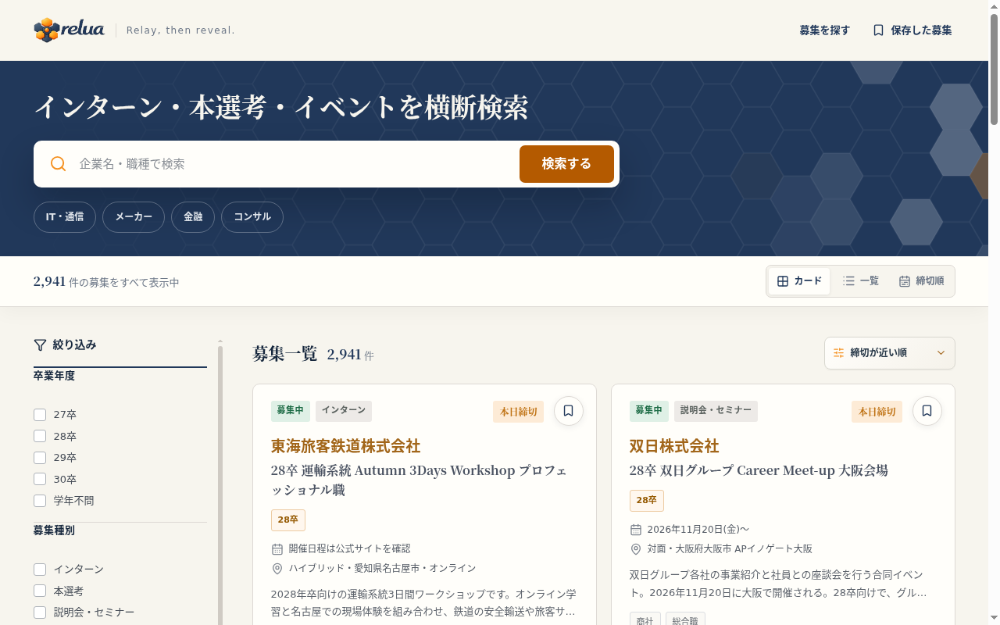
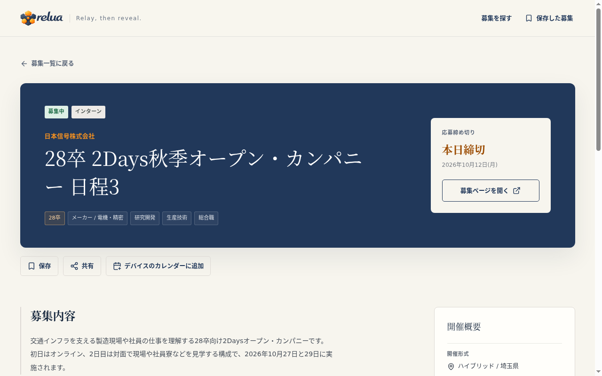
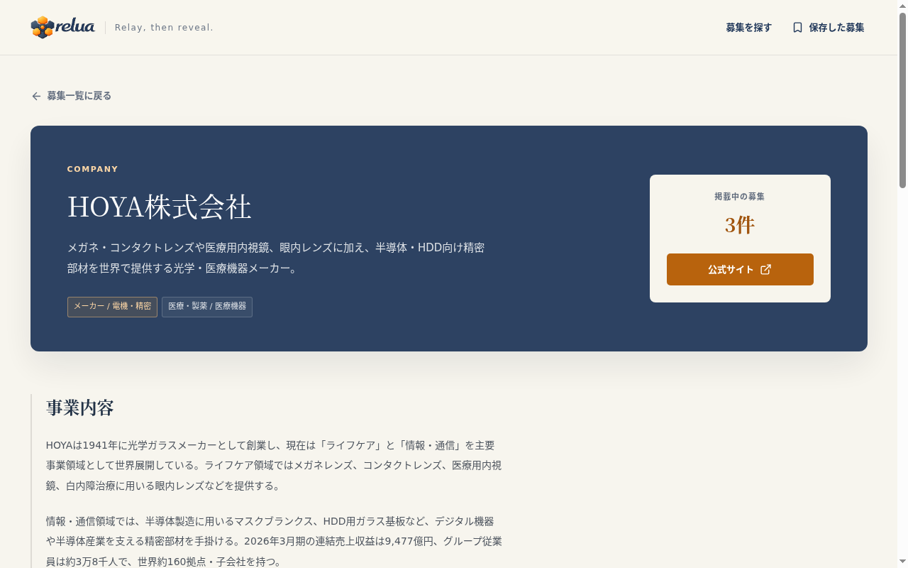
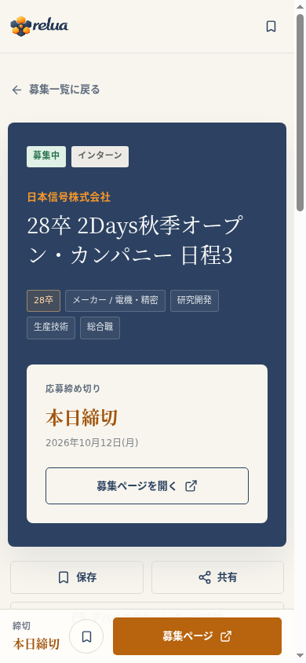
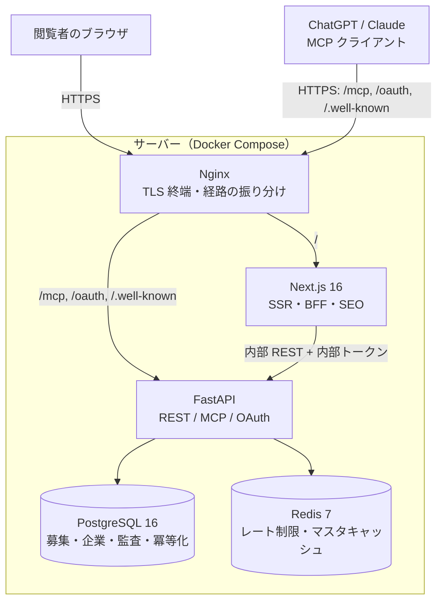
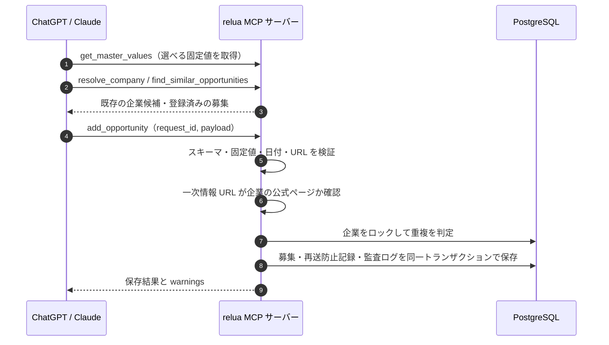
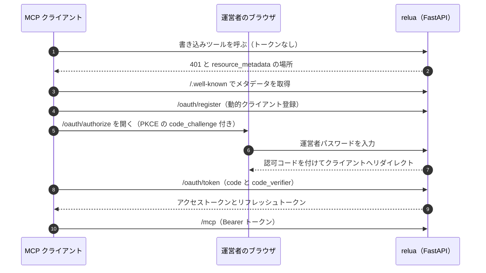
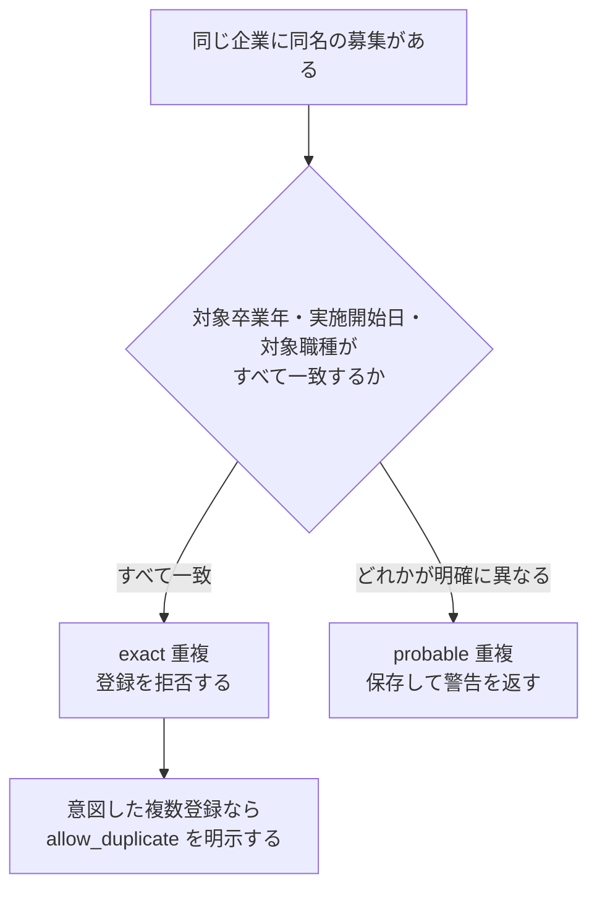

# relua

**インターン・本選考・イベントの募集情報を、ログインなしで横断検索できる就活情報サービスです。**
募集データの登録と更新は、運営者が ChatGPT や Claude から MCP（Model Context Protocol）で行います。管理画面は持たず、AI クライアントが企業の公式ページを読んで書き込む前提で、入力検証・重複防止・冪等化・監査をサーバー側に作り込んでいます。

公開サイト: <https://relua.net>

## 目次

- [特徴](#特徴)
- [画面](#画面)
- [アーキテクチャ](#アーキテクチャ)
- [MCPによるデータ更新の仕組み](#mcpによるデータ更新の仕組み)
- [OAuth 2.1 による接続](#oauth-21-による接続)
- [重複防止](#重複防止)
- [技術選定](#技術選定)
- [品質と運用](#品質と運用)
- [ドキュメント](#ドキュメント)
- [ライセンス](#ライセンス)

## 特徴

| | 内容 |
| --- | --- |
| **AIが更新するデータベース** | 40 個の MCP ツールを公開し、検索から登録・更新・削除・復元、企業プロフィールの整備、巡回キューの管理までを ChatGPT・Claude から操作できます |
| **書き込みの多層防御** | 固定値マスタ、公式ページの allowlist、2 段階の重複判定、`request_id` による冪等化、楽観ロック、監査ログを全書き込みに適用します |
| **自前の OAuth 2.1 認可サーバー** | 動的クライアント登録と PKCE に対応し、Web 版の ChatGPT・Claude に URL を登録するだけで接続できます |
| **アカウント不要の閲覧体験** | ブックマークはブラウザ内に保存し、URL や QR コードで別端末へ引き継げます。サーバーは個人の保存履歴を持ちません |
| **公開境界の最小化** | インターネットに出すのは Next.js と `/mcp`・OAuth の経路だけです。REST API と DB は外から到達できません |

## 画面

| 募集詳細 | 企業ページ |
| --- | --- |
|  |  |
| 締め切り、対象卒年、職種、開催概要を表示し、公式の募集ページへ誘導します。保存・共有・カレンダー追加ができます | MCP 経由で登録した事業内容と、その企業の現在・過去の募集をまとめて表示します |

スマートフォンでは、締め切りと募集ページへのボタンを画面下部に固定します。

主な画面は次のとおりです。

- **検索**（`/`）: キーワード検索、卒業年度・募集種別・業界などの複合絞り込み、並び替え、カード／一覧／締切順の表示切り替え
- **募集詳細**（`/opportunities/{公開コード}`）: 募集内容、開催概要、端末のカレンダーへ渡す ICS の生成
- **企業**（`/companies/{公開コード}`）: 事業内容、主な事業、現在と過去の募集
- **保存した募集**（`/saved`）: ブックマーク、最近見た募集、QR コードによる端末間の引き継ぎ、共有リスト、JSON・CSV バックアップ

## アーキテクチャ

設計上の要点は次の 3 つです。

- **REST API は非公開です。** ブラウザは Next.js としか通信せず、Next.js のサーバー側だけが内部トークンを付けて FastAPI を呼びます。Nginx は `/api/v1` を外へ出しません（[ADR-0001](./docs/decisions/0001-private-api-and-next-bff.md)）。
- **書き込みの入口は MCP だけです。** Web 画面にも REST にも書き込み経路がないため、検証・重複判定・監査を 1 か所に集約できます。
- **秘密情報は閉じる側に倒します。** リポジトリに載っている開発用の値で本番起動しようとすると、アプリが起動を拒否します（[ADR-0019](./docs/decisions/0019-fail-closed-secrets-and-trusted-proxy.md)）。

構成要素ごとの責務とリクエスト経路は [`ARCHITECTURE.md`](./ARCHITECTURE.md) にまとめています。

## MCPによるデータ更新の仕組み

運営者は AI クライアントに「この企業の採用ページを確認して登録して」と頼みます。AI は公式ページを読み、relua の MCP ツールを順に呼びます。サーバーは AI の入力を信用せず、すべての書き込みを同じ検証の列に通します。

40 個のツールのうち、検索や固定値の取得など 6 個は認証なしで使えます。書き込みと運営用の 34 個は認証が必要です。各ツールは `title`、`annotations`（読み取り専用かどうか）、`outputSchema` を公開するので、クライアント側で自動承認の可否を判断できます。

書き込みを守る仕組みは次のとおりです（[ADR-0002](./docs/decisions/0002-mcp-write-safety.md)）。

| 仕組み | 防ぐもの | 動作 |
| --- | --- | --- |
| 固定値マスタ | 表記ゆれ、AI が勝手に作る分類 | 業界・業種・募集種別・卒年などはマスタにある値だけを受け付けます |
| 公式ページの allowlist | 求人サイトや口コミサイトの転載 | 一次情報 URL は、企業ごとに登録した公式ホスト配下だけを許可します（[ADR-0013](./docs/decisions/0013-official-source-allowlist-and-check-evidence.md)） |
| `request_id` による冪等化 | 通信の再試行による二重登録 | 同じ ID・同じ内容の再送には前回の結果を返し、内容が違えば拒否します |
| 楽観ロック | 古い取得結果での上書き | 更新・削除には取得時の `updated_at` が必須で、行をロックしてから一致を確認します |
| 監査ログ | 何が起きたか分からない状態 | 成功も拒否も、変更前後の内容とともに記録します。実行単位の `run_id` で後から照合できます |
| 論理削除 | 誤削除 | 削除から 30 日間は同じ ID・公開コードのまま復元できます |
| 書き込みと確認の分離 | 見ていないのに「確認済み」になること | 内容の更新では確認日時を進めません。公式ページを確認した事実は別のツールで記録します（[ADR-0010](./docs/decisions/0010-write-verification-separation.md)） |

判断が必要な場面では、自動で確定させずに警告を返します。たとえば「募集中」なのに締め切りが過去の募集は、締切延長の可能性があるため状態を自動変更せず、要確認キューの先頭に出します（[ADR-0009](./docs/decisions/0009-soft-date-status-validation.md)）。

募集がまだない企業も巡回対象として登録でき、確認期限を過ぎた企業を優先度順に返すキューを MCP から取得できます。確認できない状態が続く企業は、再確認の間隔を自動で延ばします（[ADR-0027](./docs/decisions/0027-maintenance-recheck-scheduling.md)）。

## OAuth 2.1 による接続

Web 版の ChatGPT や Claude は、MCP サーバーへ任意のヘッダーを付けられません。そこで FastAPI 内に OAuth 2.1 の認可サーバーを実装し、MCP の URL を登録するだけで接続できるようにしています。

- **標準仕様に沿った探索**: RFC 9728（保護リソースのメタデータ）と RFC 8414（認可サーバーのメタデータ）でエンドポイントを公開し、RFC 7591 の動的クライアント登録を受け付けます。
- **PKCE（S256）必須**: 認可コードを横取りされても、`code_verifier` がなければトークンに交換できません。
- **リフレッシュトークンのローテーション**: 使うたびに入れ替え、古いトークンが再利用されたら、その接続で発行した全トークンを失効させます。
- **トークンは保存しない**: DB には SHA-256 のハッシュだけを保存します。DB が漏れても有効なトークンは得られません。
- **ログイン試行の制限**: 接続元 IP とクライアントの単位で数え、IP を特定できない構成では全体の上限で止めます。Redis に接続できないときは、制限なしで通さずログインを止めます。
- **読み取りは認証不要**: 接続前でもツール一覧と検索系ツールは使えるので、クライアントは必要になった時点で OAuth を開始します。

手元の端末から使うだけなら、固定の Bearer トークンでも接続できます。設定方法は [`docs/usage.md`](./docs/usage.md) にあります。

## 重複防止

AI に登録を任せると、同じ募集を何度も登録したり、表記の違う同じ企業を別々に作ったりします。relua は「企業」「募集」「再送」の 3 層で重複を防ぎます。

### 企業の同一性

自動で同一企業とみなすのは、正規化した正式名または登録済みの別名が完全に一致した場合だけです。部分一致と、PostgreSQL の `pg_trgm` によるタイプミス検索は候補の提示にとどめ、サーバーが勝手に企業を統合することはありません。運営者が公式情報で同一と確認したときだけ、別名の登録や企業の統合を明示的に行います（[ADR-0004](./docs/decisions/0004-company-identity-and-collection-model.md)、[ADR-0005](./docs/decisions/0005-confirmed-company-merge.md)）。

### 募集の2段階判定

同じ企業に同じ名前のイベントがあっても、別の募集であることは珍しくありません。そこで、対象卒業年・実施開始日・対象職種まで比べて 2 段階に分けます（[ADR-0011](./docs/decisions/0011-tiered-duplicate-identity.md)）。

一次情報 URL でも照合します。ホスト名の大文字小文字、末尾スラッシュ、フラグメント、計測パラメータを取り除いて比べます。ただし 1 つの公式ページに複数の募集が載ることがあるため、URL の一致は拒否ではなく確認用の警告にしています。

### 再送の冪等化

すべての書き込みは `request_id` と内容のハッシュを記録します。通信が切れて結果が分からないときは、同じ ID で再送すれば前回の結果が返り、二重には保存されません。再送の保証期間は 90 日で、それより古い記録は圧縮アーカイブへ移します（[ADR-0028](./docs/decisions/0028-history-archive-and-idempotency-retention.md)）。

## 技術選定

| 領域 | 採用技術 | 選んだ理由 |
| --- | --- | --- |
| フロントエンド | Next.js 16（App Router）、React 19、TypeScript | 検索結果と詳細を SSR で返し、canonical・構造化データ・サイトマップまで同じ場所で管理するため。サーバー側を BFF にして、内部トークンをブラウザへ渡さずに済みます |
| スタイル | Tailwind CSS 4、単一の `globals.css` | トークンと意味クラスを 1 ファイルに集約し、画面ごとの見た目のばらつきを防ぐため |
| バックエンド | FastAPI、Pydantic、SQLAlchemy 2 | MCP の入力をスキーマで厳密に検証し、REST・MCP・OAuth を 1 つのアプリにまとめるため |
| MCP | 公式 MCP Python SDK（Streamable HTTP） | ChatGPT・Claude の両方が対応する転送方式で、FastAPI と同じプロセスに載せられるため |
| データベース | PostgreSQL 16、Alembic | 行ロックとトランザクションで重複判定と保存を一体にするため。`pg_trgm` で企業名のタイプミス検索と関連度順の検索も賄えます |
| キャッシュ | Redis 7 | ログイン試行と動的クライアント登録のレート制限、固定値マスタのキャッシュに使います |
| 個人データ | ブラウザの `localStorage` と URL フラグメント | アカウントを作らずに保存と共有を実現し、サーバーに個人の履歴を持たないため（[ADR-0003](./docs/decisions/0003-local-browser-data-and-public-codes.md)） |
| 実行基盤 | Docker Compose、Nginx | 1 台のサーバーで動かせる規模に合わせ、公開する経路を Nginx の設定 1 ファイルで管理するため |
| CI/CD | GitHub Actions | テスト、PostgreSQL でのマイグレーション検証、デプロイ、日次保守を同じ場所で実行・監視するため |

## 品質と運用

- **自動テスト**: バックエンド約 280 件、フロントエンド約 150 件。CI では SQLite での単体テストに加え、PostgreSQL に対するマイグレーションと `pg_trgm` 検索も検証します。
- **デプロイ**: `main` へのマージで自動デプロイし、各サービスのヘルスチェックに失敗したら直前のコミットへ自動で戻します。
- **日次保守**: 90 日を過ぎた監査ログと確認履歴の圧縮アーカイブ、論理削除から 30 日を過ぎた募集の完全削除、期限切れ認可コードの削除を毎日実行し、完了マーカーを検証します。
- **SEO の障害耐性**: API が落ちているときに空のページを 200 で返さず 5xx を返し、検索エンジンに誤った内容を拾わせません（[ADR-0016](./docs/decisions/0016-seo-outage-resilience-and-reviewed-facets.md)）。
- **設計判断の記録**: 28 件の ADR に、採用した案と理由、トレードオフを残しています。

## ドキュメント

| 文書 | 内容 |
| --- | --- |
| [`ARCHITECTURE.md`](./ARCHITECTURE.md) | システム構成、責務、リクエスト経路、データモデルと不変条件 |
| [`docs/decisions/`](./docs/decisions/README.md) | 技術判断の記録（ADR） |
| [`docs/usage.md`](./docs/usage.md) | 起動手順、MCP クライアントの設定、MCP ツール一覧、運用手順 |
| [`docs/knowledge/`](./docs/knowledge/README.md) | 開発規約、用語集、デバッグの手引き |
| [`AGENTS.md`](./AGENTS.md) | このリポジトリで作業する AI エージェント向けのルール |

## ライセンス

ソースコードは [MIT License](./LICENSE) で公開しています。「relua」の名称とロゴ（`frontend/public/` の画像）、および本番サービスに掲載している募集・企業データは、このライセンスの対象外です。
